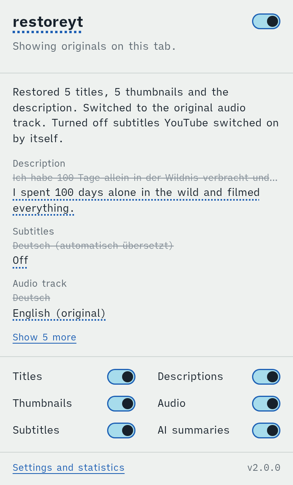
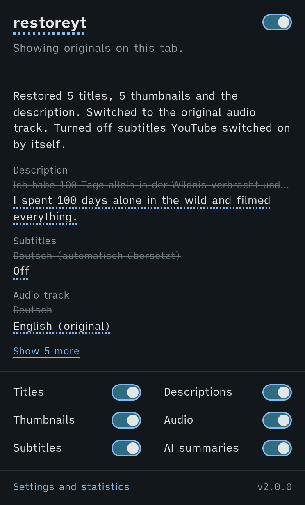

# restoreyt

See YouTube videos the way their creators uploaded them.

YouTube localizes what you watch. Titles and descriptions get translated into your interface language. Thumbnails get swapped for per-language versions. Videos start in a dubbed, often AI-dubbed, audio track. Subtitles switch on by themselves, and an AI summary sits under the video. restoreyt puts the originals back.

<p>
  
  
</p>

## What it restores

| | YouTube shows | restoreyt shows |
|---|---|---|
| Titles | Translated titles and A/B test titles | The creator's title in feeds, search, the watch page, Shorts, playlists, the player and the browser tab |
| Descriptions | Machine-translated text | The creator's text, with working links, timestamps, hashtags and @handles |
| Thumbnails | Per-language thumbnails and test variants | The creator's main thumbnail |
| Audio | A dubbed or AI-dubbed track in your language | The original audio track. If you pick another track yourself, it stays picked |
| Subtitles | Subtitles YouTube switched on by itself | Off, unless you turn them on |
| AI summaries | An AI-generated summary under the video | Hidden |

Every feature has its own switch. The popup shows what changed on the current page: YouTube's version struck through, the creator's original underneath. The settings page explains each option and shows lifetime counts.

## Install

### Chrome, Edge, Brave (Chromium 121+)

```bash
npm ci
npm run build
```

Open `chrome://extensions`, enable **Developer mode**, choose **Load unpacked** and select this folder. Reload open YouTube tabs once.

### Firefox 128+

Firefox support is built in (MAIN-world content scripts need Firefox 128) but gets less testing than Chromium.

```bash
npm ci
npm run package
```

Open `about:debugging#/runtime/this-firefox`, choose **Load Temporary Add-on** and select `.dist/firefox/manifest.json`. If Firefox has not granted access to YouTube yet, the popup shows an **Allow access** button.

`manifest.json` in the repository is the Chromium manifest. `npm run package` derives the Firefox one (event-page background, add-on ID) and writes minified, installable `.dist/restoreyt-chrome.zip` and `.dist/restoreyt-firefox.zip`.

## How it works

- **Titles.** Each title on the page is matched to its video ID. Originals come from YouTube's public oEmbed endpoint, called without cookies, six at a time and only for titles near the viewport. Results are kept on the device for 14 days. When YouTube later shows a different text for a video, the entry is checked again, so creator renames are picked up. Watch-page and Shorts titles come from the page's own player data and need no request. Videos oEmbed refuses (embedding disabled) fall back to YouTube's player endpoint. Only the text node changes, so links, hover previews and layout stay YouTube's own.
- **Descriptions.** The original text comes from the page's player data. It replaces the shown description only when the shown text is a translation (word-overlap check), so untranslated descriptions keep YouTube's rich rendering.
- **Thumbnails.** Two `declarativeNetRequest` redirect rules (`rules/thumbnails.json`) send `i.ytimg.com/vi_lc/ID/hq720_de.jpg` to `i.ytimg.com/vi/ID/hq720.jpg` and test variants (`hq720_custom_2.jpg`) to the main image, always in the same size tier. Nothing flickers because the swapped image is never downloaded.
- **Audio.** Track IDs carry an `acont=original|dubbed` tag. restoreyt switches to the original once per video load through the player API. Display names and YouTube's "default" flag follow your language, so they are not used.
- **Subtitles.** When YouTube's initial decision for the track is "on, recommended", subtitles are switched off once as the video starts.
- **AI summaries.** A stylesheet hides `ytd-expandable-metadata-renderer[has-video-summary]`.

```text
src/
  page/         MAIN world: player access (audio, subtitles, original metadata), player-endpoint fallback
  content/      isolated world: title engine, description, lookups and cache, page report
    surfaces.ts   every place YouTube renders a title: change this file when YouTube changes markup
  shared/       settings schema, message contracts, YouTube URL helpers
  popup/ options/ ui/   extension pages
  background.ts redirect ruleset switch, toolbar badge, cache pruning, lifetime counters
rules/thumbnails.json   thumbnail redirect rules
```

## Permissions

| Permission | Why |
|---|---|
| `storage` | Settings (synced) plus the title cache and counters (local) |
| `declarativeNetRequest` | Redirect localized and test thumbnails to the original |
| `www.youtube.com`, `www.youtube-nocookie.com` | Run on YouTube pages and embedded players, look up original titles |
| `i.ytimg.com` | Required by the browser for redirect rules on thumbnail requests |

## Privacy

No telemetry and no servers of its own. The only requests restoreyt makes go to YouTube: oEmbed lookups on `www.youtube.com` without cookies, the player endpoint for videos oEmbed refuses, and thumbnails from `i.ytimg.com`. On the device it keeps settings, cached titles (up to 14 days) and counters. Details in [PRIVACY_POLICY.md](PRIVACY_POLICY.md).

## Development

```bash
npm run verify       # version check, lint, strict typecheck, unit tests, build
npm run test:e2e     # real extension in Chromium against a local fake YouTube (no network)
npm run test:live    # real extension against live YouTube with a German interface
npm run screenshots  # popup and settings page, light and dark
npm run watch        # rebuild on change
```

`test:live` is a maintainer tool: YouTube changes markup, runs ads and A/B tests. Run it after YouTube redesigns or before a release. It uses a fresh logged-out profile and no account.

## Limitations

- Desktop site (`www.youtube.com`) and embeds. The mobile site, YouTube Music and TV apps are not covered.
- Chapter names in the progress bar and chapter list stay as YouTube shows them. The description, including its timestamps, is restored.
- Channel names and banners are left unchanged.
- Titles of private or removed videos stay as shown, because YouTube has no original to give.
- YouTube's markup changes often. All title selectors live in `src/content/surfaces.ts`, and `npm run test:live` shows what broke.

restoreyt is independent software, not affiliated with or endorsed by YouTube or Google.

## Credits and license

Code: [MIT](LICENSE). Interface typeface: iA Writer Quattro by iA Inc., based on IBM Plex, bundled unmodified under the SIL Open Font License ([fonts/OFL.txt](fonts/OFL.txt)).
